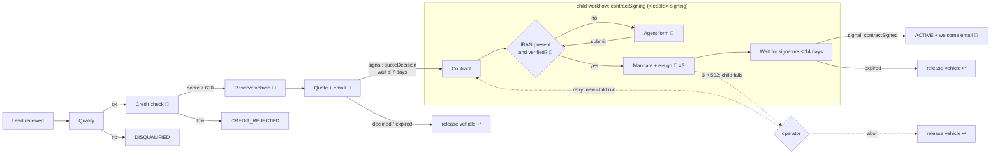

# Car-lease onboarding: Temporal PoC (TypeScript)

A Temporal workflow that takes a car-lease customer from **lead** to **active leasing contract**.
Each step writes to a local SQLite database. The external systems (credit bureau, inventory,
e-signature, email) are mocks that you can make fail, slow down or hang, so you can show how
Temporal retries.



🔁 = calls a flaky external service and is retried by Temporal. ↩ = compensation (saga). 👤 = waits for a human agent.

Contract signing runs as a **child workflow** with a fixed ID (`<leadId>-signing`). It has its own
lifecycle (up to 14 days), and you can reset it on its own: the parent keeps waiting and picks up
the result of the child's new run. The credit check and vehicle reservation don't run again.

### Agent form: missing or wrong IBAN

The contract needs a SEPA direct-debit mandate, so the child needs a verified IBAN before it
sends anything for signature. `iban` is optional in the application. When it's missing, or when it
fails verification, the child opens a form in the **agent inbox** at
http://localhost:3000/agent and waits for an agent, without a timeout.

A submitted value goes through three checks. Any failure sends the agent back to the form with the
reason:

| Check                         | Where                     | On failure                                           |
|-------------------------------|---------------------------|------------------------------------------------------|
| Format and mod-97 checksum    | update validator          | HTTP 422; nothing reaches the workflow history       |
| Account in the customer's name | workflow                 | form reopened, `rejectedSubmissions + 1`             |
| Bank IBAN-name check (mock)   | `verifyBankAccount` 🔁    | form reopened (no match, closed, not found)          |

The submit is a workflow update (`submitPaymentDetails`). Its handler waits for the workflow's
verdict, so the agent sees "accepted" or the reason for rejection in the same request. Open forms
are also recorded in the `agent_tasks` table, and the verified IBAN in `payment_mandates`.

Demo IBANs known to the mock bank (they're also listed on the agent page):

| IBAN                     | Bank record                     |
|--------------------------|---------------------------------|
| `NL91 ABNA 0417 1643 00` | J. Jansen: matches the demo customer |
| `NL20 INGB 0001 2345 67` | P. de Vries                     |
| `NL44 RABO 0123 4567 89` | J. Jansen, account closed       |
| `NL51 ABNA 0987 6543 21` | P. Bakker                       |
| `NL00 ABNA 0417 1643 00` | invalid checksum                |

Any other well-formed IBAN is "not found".

## Layout

Each workflow has its own folder with its activities next to it. Child workflows live under their
parent's `childWorkflows/` folder. Types sit in `types.ts`, and signals, queries and updates in
`messages.ts`, so clients can import them without loading workflow code.

```
src/
  workflows/
    index.ts                        workflow registry (worker's workflowsPath): workflow functions only
    activities.ts                   activity registry: merges every activities/ folder
    common/                         shared by all workflows
      activity-options.ts           retry policies and timeouts (local, external, e-sign)
      activity-support.ts           tracked() audit rows, callExternal(): 5xx/408/429 retryable, other 4xx not
      operator-recovery.ts          recovery.guard: park a step that ran out of retries
      messages.ts, types.ts         operatorAction update, OperatorCommand, ParkedStep
    carLeaseOnboarding/
      workflow.ts                   lead → credit → vehicle → quote → [child] → active lease
      messages.ts, types.ts         quoteDecision signal, getState query; LeadInput, OnboardingState, …
      activity-proxies.ts           proxies for this workflow's activities
      activities/                   lead, credit, vehicle, quote, lease, notification
      workflow.test.ts              tests with mocked activities (time-skipping test server)
      childWorkflows/
        contractSigning/
          workflow.ts               contract → IBAN (agent form if needed) → e-sign → signature
          messages.ts, types.ts     contractSigned, getSigningState, submitPaymentDetails; SigningState, …
          activity-proxies.ts       own activities + updateLeadStatus / sendEmail from the parent
          activities/               contract, payment, agentTask
  shared/                           pure helpers, also used in the workflow sandbox: iban, names, ids
  db/database.ts                    SQLite schema (leads, credit_checks, vehicle_reservations, quotes, contracts, …)
  mock-services/                    fake credit bureau / inventory / e-sign / email / bank with chaos controls
  api/                              HTTP API (start, signal, query, operator, agent inbox) + agent page
  demo/                             interactive demo CLI (npm run demo)
  scripts/                          CLI lead driver, DB viewer, workflow reset, chaos switch
  worker.ts                         Temporal worker
infra/                              Bicep + deploy script for Azure Container Apps
Dockerfile, docker-compose.yml
```

## Demo CLI

Every scenario is also written up in [docs/scenarios](docs/scenarios/README.md): what happens, how
Temporal is involved, and how to resolve it.

```bash
npm run demo                          # interactive menu of every test path
npm run demo -- esign-outage          # run one scenario directly
npm run demo -- esign-outage --yes    # non-interactive: every prompt takes its default answer
npm run demo -- --list                # scenario ids
```

When it starts, it checks that Temporal, the worker, the mock services and the API are up, and
tells you which command to run for anything that's missing. Pick a scenario to see what to
expect. The CLI then starts the lead, plays the customer (accepting the quote and signing), and
stops where a human is needed:

| Group                 | Scenario                                     | You do                                    |
|-----------------------|----------------------------------------------|-------------------------------------------|
| Happy path            | Happy path                                   | nothing; watch the retries                |
| Human in the loop     | Missing IBAN → agent form                    | submit IBANs from the terminal or `/agent` |
|                       | Application IBAN fails verification          | same form, opened with the bank's reason  |
|                       | Customer declines the quote                  | nothing; the car is released              |
| Failure & recovery    | E-sign outage → child fails → fix and retry  | choose: fix + retry, retry, or abort      |
|                       | Credit bureau outage → retries → operator    | recover mid-way, or after ~2.5 min        |
|                       | Hanging inventory → activity timeout         | nothing; watch the 10 s timeout           |
|                       | Unknown vehicle model → non-retryable        | nothing; fails fast                       |
|                       | Credit rejected (business outcome)           | nothing                                   |
| Temporal power tools  | Reset only the signing child                 | confirm the reset                         |
|                       | Worker crash while waiting                   | stop and restart `npm run dev`            |

Each run ends with a summary: the final status, a timeline, the retries and re-runs per step (read
from the Temporal history), every workflow run, and links to the Temporal UI and `db:show`. Mock
services are reset to their defaults before and after every scenario, and on Ctrl+C, so a scenario
never leaves a service down.

## Scenarios

```bash
npm run lead -- --auto --scenario happy        # valid IBAN in the application: runs straight through to ACTIVE
npm run lead -- --auto --scenario agent-form   # no IBAN: open http://localhost:3000/agent and fill in the form
npm run lead -- --auto --iban NL20INGB0001234567   # IBAN that fails verification: the form opens with the reason
npm run lead -- --auto --scenario esign-outage # e-sign provider down: the signing child fails, then you fix and retry
```

### E-sign outage: the child fails, you fix the API and retry

1. `npm run lead -- --auto --scenario esign-outage` switches the mock e-sign provider down (every
   call returns 502) and starts a lead with a valid IBAN.
2. The e-sign call is allowed **3 attempts** (`ESIGN_ACTIVITY` in `src/workflows/common/activity-options.ts`). After the third
   502 the signing child **fails**; the Temporal UI shows `<leadId>-signing` as Failed with the 502.
3. The parent doesn't fail. It goes to `NEEDS_ATTENTION` (step `contractSigning`), and the
   vehicle **stays reserved**. The CLI prints the next two commands:
   ```bash
   npm run chaos -- esign up                                   # "fix" the API: 200s again
   curl -X POST localhost:3000/leads/<leadId>/operator \
        -H 'content-type: application/json' -d '{"action":"retry"}'
   ```
4. `retry` starts a **new run** of the signing child under the same ID. It reuses the IBAN mandate
   the first run already verified, so no agent form and no second bank check. It then sends the
   contract and the lead finishes `ACTIVE`. The UI shows the failed run next to the completed one.
   The credit check and vehicle reservation are not repeated.
5. `{"action": "abort"}` instead fails the lead and releases the vehicle.

Why the parent waits instead of failing too: if the parent failed, it would release the car right
away, and a later reset would continue as if the car were still reserved. Resetting the failed
child afterwards doesn't help either, because the parent has already received the failure.

`npm run chaos` shows the mock settings, `npm run chaos -- <service> down|up` switches any mock
service, and `npm run chaos -- reset` restores the defaults.

## Run locally

Prerequisites: Node 22+ and the Temporal CLI (`brew install temporal`).

```bash
npm install
cp .env.example .env          # optional, the defaults work locally

npm run temporal              # terminal 1: Temporal dev server + UI on http://localhost:8233
npm run dev                   # terminal 2: mock services (:8081), worker, API (:3000)
npm run demo                  # terminal 3: interactive menu of every test path
npm run lead -- --auto        # or: run one onboarding from a script, playing the customer
npm run db:show               # inspect the SQLite database
```

Or run everything in containers with `docker compose up --build`.

### API

```bash
curl -X POST localhost:3000/leads -H 'content-type: application/json' -d '{
  "firstName": "Jan", "lastName": "Jansen", "email": "jan@example.com",
  "dateOfBirth": "1988-05-17", "annualIncome": 62000, "vehicleModel": "Volvo EX30",
  "iban": "NL91ABNA0417164300",
  "options": { "quoteDecisionTimeout": "5 minutes" }
}'
# → { "leadId": "lead-1a2b3c4d" }

curl localhost:3000/leads/lead-1a2b3c4d                                    # live state (query)
curl -X POST localhost:3000/leads/lead-1a2b3c4d/quote-decision \
     -H 'content-type: application/json' -d '{"accepted": true}'          # signal
curl -X POST localhost:3000/leads/lead-1a2b3c4d/sign                       # signal to the signing child
curl -X POST localhost:3000/leads/lead-1a2b3c4d/operator \
     -H 'content-type: application/json' -d '{"action": "retry"}'          # resume a NEEDS_ATTENTION step
```

`GET /leads/:id` also returns the signing child's state (`signing.stage`) once the child has started.

Agent endpoints (used by the page at `/agent`):

```bash
curl localhost:3000/agent/tasks                                            # open forms
curl -X POST localhost:3000/agent/tasks/lead-1a2b3c4d-signing/payment-details \
     -H 'content-type: application/json' \
     -d '{"iban": "NL91ABNA0417164300", "accountHolder": "Jan Jansen"}'
```

Vehicle models: `Volvo EX30`, `Tesla Model 3`, `Kia EV6`, `Volkswagen ID.4`, `BMW i4`, `Skoda Enyaq`.

## Demoing retries

Default chaos settings in the mock services:

| Service       | Behaviour by default                         | Shows                    |
|---------------|----------------------------------------------|--------------------------|
| credit bureau | fails the **first 2 calls** per lead (503)   | deterministic retries    |
| inventory     | **30 %** of calls fail (500), 800 ms latency | random transient errors  |
| e-sign        | **never fails** by default (502 when down)   | `--scenario esign-outage` / `npm run chaos -- esign down` |
| notifications | **20 %** of calls fail (503)                 | random transient errors  |

Retries show up in three places: the Temporal UI (the *Pending Activities* panel and the
`attempt` count), the mock-services log, and the `workflow_events` table, which has one row per
activity attempt (`npm run db:show -- <leadId>`).

Change the chaos settings at runtime:

```bash
curl localhost:8081/admin/chaos                                   # current settings
curl -X POST localhost:8081/admin/chaos -H 'content-type: application/json' \
     -d '{"creditBureau": {"failFirstN": 5}}'                     # more retries
curl -X POST localhost:8081/admin/chaos -H 'content-type: application/json' \
     -d '{"inventory": {"latencyMs": 15000, "failureRate": 0}}'  # hang → 10s timeout → retry
curl -X POST localhost:8081/admin/chaos/reset                     # defaults + reset counters
```

Scenarios worth showing:

1. **Transient failures**: `npm run lead -- --auto`. The credit check fails twice and then succeeds.
2. **Outage, then recovery**: set `{"creditBureau": {"failureRate": 1}}`, start a lead, and watch
   the attempts and the growing backoff (1s, 2s, 4s … 30s) in the UI. Then set `failureRate` back to `0`.
   The workflow continues from where it was. If you leave it down for longer than about 2.5
   minutes (10 attempts), see the next scenario.
3. **Out of retries → operator**: keep a service down until its retries run out. The lead goes to
   `NEEDS_ATTENTION` and `GET /leads/:id` shows the step and the last error in `needsAttention`
   (or in `signing.needsAttention` for the signing child). Fix the cause, then
   `POST /leads/:id/operator` with `{"action": "retry"}` to run the step again with a fresh retry
   policy, or `{"action": "abort"}` to fail the lead and release the vehicle.
4. **Worker crash**: stop `npm run dev` while a workflow waits for a quote decision, then start it again
   and send the signal. Nothing is lost.
5. **Timeout**: set inventory `latencyMs` to 15000. The 10-second `startToCloseTimeout` expires and
   the activity is retried.
6. **Non-retryable error**: `npm run lead -- --auto --model "Fiat Multipla"`. Inventory returns 404,
   the workflow fails immediately without retrying, and the lead is marked `FAILED`.
7. **Business rejection (not an error)**: `npm run lead -- --auto --email jan+reject@example.com` ends in `CREDIT_REJECTED`.
8. **Compensation**: `npm run lead -- --auto --decline`. The reserved vehicle is released (see `vehicle_reservations`).
9. **Reset only the child**: start a lead with `npm run lead`, accept the quote, and wait for
   `signing.stage` to be `AWAITING_SIGNATURE`. Then run `npm run reset -- <leadId>-signing`. The child's old run is
   terminated and a new run creates the contract and sends the e-sign envelope again (both are
   idempotent). The parent keeps waiting. `POST /leads/<leadId>/sign` then completes the lease.
   In `workflow_events`, only `createContract`, `requestSignature` and `sendEmail:contract-ready`
   appear twice.

Retry policies live in `src/workflows/common/activity-options.ts`. External calls are wrapped in
`recovery.guard` (`src/workflows/common/operator-recovery.ts`). When a call runs out of attempts (10), the
workflow doesn't fail: it parks the step and waits for an operator, without a timeout. The
operator command is a workflow **update**, not a signal, so the workflow can reject it when nothing
is parked; the API returns 409 in that case. Non-retryable failures (such as the unknown-model 404)
still fail the workflow immediately, because retrying the same input won't help.

### Tests (mocked activities)

```bash
npm test
```

`src/workflows/carLeaseOnboarding/workflow.test.ts` replaces the activities with mocks that throw on purpose. The
tests check that a flaky service is retried until it succeeds (attempts `[1, 2, 3]`), that a
service that stays down is called `maximumAttempts` times and then parked until an operator sends
`retry`, that an operator `abort` fails the lead and releases the vehicle, that a non-retryable
error is called once, that the 7-day quote timeout releases the vehicle, that an expired signature in
the child workflow leads to compensation in the parent, that the agent form keeps reopening
until a valid IBAN is submitted, and that an e-sign outage fails the child after 3 attempts while
the parent keeps the car and retries signing (or releases the car on abort). The time-skipping server
makes the backoffs and timers pass instantly.

## Deploy to Azure Container Apps

`infra/main.bicep` creates the following:

| App                  | Role                       | Ingress                     | Replicas |
|----------------------|----------------------------|-----------------------------|----------|
| `carlease-api`       | HTTP API                   | external HTTPS              | 1–3      |
| `carlease-worker`    | Temporal worker + SQLite   | none                        | 1        |
| `carlease-mocks`     | mock external services     | internal HTTP               | 1        |
| `carlease-temporal`  | Temporal dev server *      | internal TCP :7233          | 1        |
| `carlease-temporal-ui` | Temporal UI *            | external, your IP only      | 1        |

\* only when `TEMPORAL_MODE=devserver` (the default).

It also creates Log Analytics, an Azure Container Registry, a managed identity with AcrPull, and a
VNet. The VNet is needed for TCP ingress to the Temporal gRPC port.

```bash
az login
./infra/deploy.sh                       # creates the RG, builds the image in ACR, deploys the apps
```

The script prints the API URL and the Temporal UI URL. The UI only accepts traffic from your
current public IP. The image is built with `az acr build`, so you don't need Docker locally.

**Temporal Cloud** (recommended for anything beyond a quick demo):

```bash
TEMPORAL_MODE=cloud \
TEMPORAL_CLOUD_ADDRESS=my-ns.a1b2c.tmprl.cloud:7233 \
TEMPORAL_CLOUD_NAMESPACE=my-ns.a1b2c \
TEMPORAL_CLOUD_API_KEY=... \
./infra/deploy.sh
```

Inspect the worker's database in Azure:

```bash
az containerapp exec -g rg-carlease-poc -n carlease-worker --command "node dist/scripts/show-db.js"
```

### PoC limitations

- **The dev server is in-memory.** All workflow history is lost when its replica restarts. Use
  Temporal Cloud or a self-hosted cluster with Postgres for anything real.
- **SQLite lives on the worker replica's disk.** The worker is therefore pinned to one replica, and
  the data is lost when the revision changes. For anything beyond the PoC, move to Azure SQL or
  Postgres. The activities already use idempotent upserts, so this is a contained change.
- The mock services keep their state in memory and are pinned to one replica.
