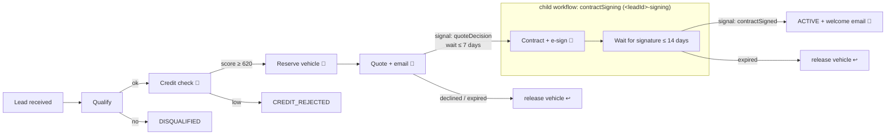

# Car-lease onboarding: Temporal PoC (TypeScript)

A Temporal workflow that takes a car-lease customer from **lead** to **active leasing contract**.
Each step writes to a local SQLite database. The external systems (credit bureau, inventory,
e-signature, email) are mocks that you can make fail, slow down or hang, so you can show how
Temporal retries.



🔁 = calls a flaky external service and is retried by Temporal. ↩ = compensation (saga).

Contract signing runs as a **child workflow** with a fixed ID (`<leadId>-signing`). It has its own
lifecycle (up to 14 days), and you can reset it on its own: the parent keeps waiting and picks up
the result of the child's new run. The credit check and vehicle reservation don't run again.

## Layout

```
src/
  workflows/onboarding.ts       parent workflow: steps, signals, query, compensation
  workflows/contract-signing.ts child workflow: contract, e-signature, wait for signature
  workflows/activity-proxies.ts retry policies and timeouts for local and external activities
  workflows/onboarding.test.ts  tests with mocked activities (time-skipping test server)
  activities/                   one file per domain; each writes to SQLite + audit trail
  activities/support.ts         HTTP helper: 5xx/408/429/network → retryable, other 4xx → non-retryable
  db/database.ts                SQLite schema (leads, credit_checks, vehicle_reservations, quotes, contracts, workflow_events)
  mock-services/server.ts       fake credit bureau / inventory / e-sign / email with chaos controls
  api/server.ts                 HTTP API: start onboarding, signal, query
  worker.ts                     Temporal worker
  scripts/                      CLI demo driver, DB viewer, workflow reset
infra/                          Bicep + deploy script for Azure Container Apps
Dockerfile, docker-compose.yml
```

## Run locally

Prerequisites: Node 22+ and the Temporal CLI (`brew install temporal`).

```bash
npm install
cp .env.example .env          # optional, the defaults work locally

npm run temporal              # terminal 1: Temporal dev server + UI on http://localhost:8233
npm run dev                   # terminal 2: mock services (:8081), worker, API (:3000)
npm run lead -- --auto        # terminal 3: run one onboarding, playing the customer
npm run db:show               # inspect the SQLite database
```

Or run everything in containers with `docker compose up --build`.

### API

```bash
curl -X POST localhost:3000/leads -H 'content-type: application/json' -d '{
  "firstName": "Jan", "lastName": "Jansen", "email": "jan@example.com",
  "dateOfBirth": "1988-05-17", "annualIncome": 62000, "vehicleModel": "Volvo EX30",
  "options": { "quoteDecisionTimeout": "5 minutes" }
}'
# → { "leadId": "lead-1a2b3c4d" }

curl localhost:3000/leads/lead-1a2b3c4d                                    # live state (query)
curl -X POST localhost:3000/leads/lead-1a2b3c4d/quote-decision \
     -H 'content-type: application/json' -d '{"accepted": true}'          # signal
curl -X POST localhost:3000/leads/lead-1a2b3c4d/sign                       # signal to the signing child
curl -X POST localhost:3000/leads/lead-1a2b3c4d/operator \
     -H 'content-type: application/json' -d '{"action": "retry"}'          # resume a NEEDS_ATTENTION step
```

`GET /leads/:id` also returns the signing child's state (`signing.stage`) once the child has started.

Vehicle models: `Volvo EX30`, `Tesla Model 3`, `Kia EV6`, `Volkswagen ID.4`, `BMW i4`, `Skoda Enyaq`.

## Demoing retries

Default chaos settings in the mock services:

| Service       | Behaviour by default                         | Shows                    |
|---------------|----------------------------------------------|--------------------------|
| credit bureau | fails the **first 2 calls** per lead (503)   | deterministic retries    |
| inventory     | **30 %** of calls fail (500), 800 ms latency | random transient errors  |
| e-sign        | fails the **first call** per contract (502)  | idempotent retry         |
| notifications | **20 %** of calls fail (503)                 | random transient errors  |

Retries show up in three places: the Temporal UI (the *Pending Activities* panel and the
`attempt` count), the mock-services log, and the `workflow_events` table, which has one row per
activity attempt (`npm run db:show -- <leadId>`).

Change the chaos settings at runtime:

```bash
curl localhost:8081/admin/chaos                                   # current settings
curl -X POST localhost:8081/admin/chaos -H 'content-type: application/json' \
     -d '{"creditBureau": {"failFirstN": 5}}'                     # more retries
curl -X POST localhost:8081/admin/chaos -H 'content-type: application/json' \
     -d '{"inventory": {"latencyMs": 15000, "failureRate": 0}}'  # hang → 10s timeout → retry
curl -X POST localhost:8081/admin/chaos/reset                     # defaults + reset counters
```

Scenarios worth showing:

1. **Transient failures**: `npm run lead -- --auto`. The credit check fails twice and then succeeds.
2. **Outage, then recovery**: set `{"creditBureau": {"failureRate": 1}}`, start a lead, and watch
   the attempts and the growing backoff (1s, 2s, 4s … 30s) in the UI. Then set `failureRate` back to `0`.
   The workflow continues from where it was. If you leave it down for longer than about 2.5
   minutes (10 attempts), see the next scenario.
3. **Out of retries → operator**: keep a service down until its retries run out. The lead goes to
   `NEEDS_ATTENTION` and `GET /leads/:id` shows the step and the last error in `needsAttention`
   (or in `signing.needsAttention` for the signing child). Fix the cause, then
   `POST /leads/:id/operator` with `{"action": "retry"}` to run the step again with a fresh retry
   policy, or `{"action": "abort"}` to fail the lead and release the vehicle.
4. **Worker crash**: stop `npm run dev` while a workflow waits for a quote decision, then start it again
   and send the signal. Nothing is lost.
5. **Timeout**: set inventory `latencyMs` to 15000. The 10-second `startToCloseTimeout` expires and
   the activity is retried.
6. **Non-retryable error**: `npm run lead -- --auto --model "Fiat Multipla"`. Inventory returns 404,
   the workflow fails immediately without retrying, and the lead is marked `FAILED`.
7. **Business rejection (not an error)**: `npm run lead -- --auto --email jan+reject@example.com` ends in `CREDIT_REJECTED`.
8. **Compensation**: `npm run lead -- --auto --decline`. The reserved vehicle is released (see `vehicle_reservations`).
9. **Reset only the child**: start a lead with `npm run lead`, accept the quote, and wait for
   `AWAITING_SIGNATURE`. Then run `npm run reset -- <leadId>-signing`. The child's old run is
   terminated and a new run creates the contract and sends the e-sign envelope again (both are
   idempotent). The parent keeps waiting. `POST /leads/<leadId>/sign` then completes the lease.
   In `workflow_events`, only `createContract`, `requestSignature` and `sendEmail:contract-ready`
   appear twice.

Retry policies live in `src/workflows/activity-proxies.ts`. External calls are wrapped in
`recovery.guard` (`src/workflows/operator-recovery.ts`). When a call runs out of attempts (10), the
workflow doesn't fail: it parks the step and waits for an operator, without a timeout. The
operator command is a workflow **update**, not a signal, so the workflow can reject it when nothing
is parked; the API returns 409 in that case. Non-retryable failures (such as the unknown-model 404)
still fail the workflow immediately, because retrying the same input won't help.

### Tests (mocked activities)

```bash
npm test
```

`src/workflows/onboarding.test.ts` replaces the activities with mocks that throw on purpose. The
tests check that a flaky service is retried until it succeeds (attempts `[1, 2, 3]`), that a
service that stays down is called `maximumAttempts` times and then parked until an operator sends
`retry`, that an operator `abort` fails the lead and releases the vehicle, that a non-retryable
error is called once, that the 7-day quote timeout releases the vehicle, and that an expired signature in
the child workflow leads to compensation in the parent. The time-skipping server
makes the backoffs and timers pass instantly.

## Deploy to Azure Container Apps

`infra/main.bicep` creates the following:

| App                  | Role                       | Ingress                     | Replicas |
|----------------------|----------------------------|-----------------------------|----------|
| `carlease-api`       | HTTP API                   | external HTTPS              | 1–3      |
| `carlease-worker`    | Temporal worker + SQLite   | none                        | 1        |
| `carlease-mocks`     | mock external services     | internal HTTP               | 1        |
| `carlease-temporal`  | Temporal dev server *      | internal TCP :7233          | 1        |
| `carlease-temporal-ui` | Temporal UI *            | external, your IP only      | 1        |

\* only when `TEMPORAL_MODE=devserver` (the default).

It also creates Log Analytics, an Azure Container Registry, a managed identity with AcrPull, and a
VNet. The VNet is needed for TCP ingress to the Temporal gRPC port.

```bash
az login
./infra/deploy.sh                       # creates the RG, builds the image in ACR, deploys the apps
```

The script prints the API URL and the Temporal UI URL. The UI only accepts traffic from your
current public IP. The image is built with `az acr build`, so you don't need Docker locally.

**Temporal Cloud** (recommended for anything beyond a quick demo):

```bash
TEMPORAL_MODE=cloud \
TEMPORAL_CLOUD_ADDRESS=my-ns.a1b2c.tmprl.cloud:7233 \
TEMPORAL_CLOUD_NAMESPACE=my-ns.a1b2c \
TEMPORAL_CLOUD_API_KEY=... \
./infra/deploy.sh
```

Inspect the worker's database in Azure:

```bash
az containerapp exec -g rg-carlease-poc -n carlease-worker --command "node dist/scripts/show-db.js"
```

### PoC limitations

- **The dev server is in-memory.** All workflow history is lost when its replica restarts. Use
  Temporal Cloud or a self-hosted cluster with Postgres for anything real.
- **SQLite lives on the worker replica's disk.** The worker is therefore pinned to one replica, and
  the data is lost when the revision changes. For anything beyond the PoC, move to Azure SQL or
  Postgres. The activities already use idempotent upserts, so this is a contained change.
- The mock services keep their state in memory and are pinned to one replica.
