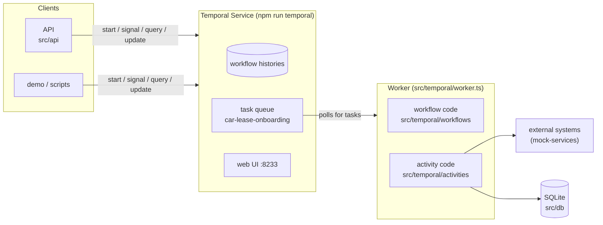

# 1 · How Temporal works here

This page follows one lead through the system. By the end you know what each part does, and why
Temporal code has a few rules that ordinary code doesn't.

## The pieces

- **The Temporal Service** stores the history of every workflow and holds the work waiting to be
  done. It never runs your code.
- **The worker** is our Node process. It polls the task queue, runs workflow and activity code, and
  reports the results back. You can run several workers, and any of them can take any task.
- **Clients** (the API, the demo, the scripts) start workflows and send them messages. They don't
  run any process logic themselves.

## One lead, step by step

1. **Start.** `POST /leads` calls `client.workflow.start('carLeaseOnboarding', { workflowId: leadId, … })`.
   The server records `WorkflowExecutionStarted` and the API returns straight away. The lead ID is
   the workflow ID, so there can only be one running onboarding per lead.

2. **Workflow task.** The worker picks up the new workflow and runs
   `carLeaseOnboarding.workflow.ts` until it needs something from outside, such as
   `await local.saveLead(…)`. The workflow doesn't call the activity itself. It asks the server to
   schedule it, and the server records `ActivityTaskScheduled`.

3. **Activity task.** A worker runs `saveLead.activity.ts`. That's normal Node code that writes to
   SQLite. The result is recorded as `ActivityTaskCompleted`, and the workflow continues.

4. **Retries.** `runCreditCheck` calls the credit bureau, which returns 503 twice. Each failure is
   recorded, and the server schedules the next attempt with exponential backoff (1 s, 2 s, …),
   following the retry policy in `workflows/common/activity-options.ts`. **The workflow code never
   sees those failures.** It just gets the result once an attempt succeeds. Only when the retries
   run out does the workflow get an error to handle (see
   [operator recovery](2-onboarding-process.md#operator-recovery)).

5. **Waiting.** After the quote is sent, the workflow calls
   `await condition(() => quoteDecision !== undefined, '7 days')`. The server records a timer, and
   the workflow stops using any resources: the worker could restart, or there could be no worker
   for a while.

6. **Signal.** The customer accepts: `POST /leads/:id/quote-decision` sends the `quoteDecision`
   **signal**. The server records it, the workflow wakes up, sees the decision and continues.

7. **Child workflow.** For the contract, the parent calls `startChild(contractSigning, …)`. The
   child has its own workflow ID (`<leadId>-signing`), its own history and its own messages. The
   parent waits for its result like it waits for an activity.

8. **Query and update.**
   - `GET /leads/:id` uses a **query**: it reads the workflow's current state and changes nothing.
   - The agent's IBAN form is submitted as an **update**: a request the workflow can validate and
     answer, like a function call into the running workflow.

9. **Done.** The workflow returns. The server records `WorkflowExecutionCompleted`, and the history
   stays available in the UI.

## What happens when a worker crashes: replay

Say the worker dies while the lead is waiting for the quote decision. A new worker picks the
workflow up, fetches its history and **runs the workflow code again from the start**. Every
`await local.saveLead(…)` and `await external.runCreditCheck(…)` returns the result already in the
history, without running the activity again. The workflow gets back to exactly where it was, and
then continues with new events.

This is the core idea of Temporal. It also explains all the rules below.

## The rules

1. **Workflow code must be deterministic.** Run with the same history, it must make the same
   decisions in the same order.
   - No I/O, no network, no database, no `process.env` in workflow code. Those belong in activities.
   - Use Temporal's APIs for time and waiting: `condition`, `sleep`, timers. Temporal's TypeScript
     sandbox makes `Date` and `Math.random` replay-safe for you.
   - Workflows import activities with `import type` only and call them through `proxyActivities`.
2. **Activities can run more than once.** A retry, or a worker that dies after the work but before
   reporting, means the same activity runs again. Make every activity **idempotent**. Here that
   means upserts in SQLite and an `idempotency-key` header on every external call.
3. **Everything that crosses the boundary is data.** Workflow input and output, activity arguments
   and results, and signals are serialised to JSON and stored in the history, so keep them small
   and plain.
4. **Changing workflow code is a deployment concern.** Running workflows are replayed with the new
   code. If the new code makes different calls in a different order, replay fails with a
   non-determinism error. Production code uses
   [versioning](https://docs.temporal.io/develop/typescript/versioning) (`patched()`) for that. In
   this PoC, terminate old runs after big changes.
5. **Failing on purpose.**
   - An error thrown in an activity is retried.
   - `ApplicationFailure.nonRetryable(…)` stops the retries (this PoC uses it for HTTP 4xx).
   - In workflow code, a Temporal failure (for example an activity that ran out of retries) fails
     the workflow. Any other exception fails only the **workflow task**, which Temporal keeps
     retrying until you deploy a fix: a bug doesn't kill the process.

## Seeing it in the UI

Open http://localhost:8233 and click a workflow:

- **Event history:** every step from the list above, with inputs and results. Expand an activity
  to see its result, for example the agent task link from `openAgentTask`.
- **Pending activities:** an activity that's retrying, with its attempt number and last error.
- **Queries:** run `getState` (the parent) or `getSigningState` (the child) to see live state.
- **Relationships:** the parent links to its `<leadId>-signing` child, including failed and
  replaced runs.

---
Next: [2 · The onboarding process →](2-onboarding-process.md)
