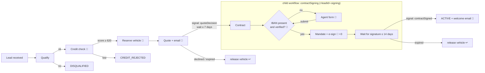

# 2 · The onboarding process

## Overview

🔁 = calls an external system and is retried by Temporal · ↩ = compensation · 👤 = waits for a person

Two workflows:
- **`carLeaseOnboarding`** (the parent): one per lead, with the lead ID as workflow ID. It runs from
  application to active lease.
- **`contractSigning`** (the child): covers everything around the contract. It runs under its own
  ID, `<leadId>-signing`.

## Steps

| # | Step | Activity | External system | Writes to |
|---|---|---|---|---|
| 1 | Register the lead | `saveLead` | | `leads` |
| 2 | Qualify (age, income, email) | `qualifyLead` | | |
| 3 | Credit check | `runCreditCheck` | credit bureau | `credit_checks` |
| 4 | Reserve the car | `reserveVehicle` | inventory | `vehicle_reservations` |
| 5 | Quote, and email it | `createQuote`, `sendEmail` | email | `quotes` |
| 6 | Wait for the customer's decision | | | *(signal `quoteDecision`)* |
| 7 | **Child:** contract | `createContract` | | `contracts` |
| 8 | **Child:** verified IBAN (agent form if needed) | `verifyBankAccount`, `savePaymentMandate` | bank | `payment_mandates`, `agent_tasks` |
| 9 | **Child:** send for e-signature | `requestSignature`, `sendEmail` | e-sign provider | `contracts` |
| 10 | **Child:** wait for the signature | | | *(signal `contractSigned`)* |
| 11 | Activate the lease, welcome email | `activateLease`, `sendEmail` | email | `contracts`, `quotes`, `vehicle_reservations` |

Every status change is written to `leads.status`, and every activity attempt to `workflow_events`.
That gives you an audit trail with attempt numbers next to the Temporal history.

## Statuses

| Status | Meaning |
|---|---|
| `LEAD_RECEIVED` → `QUALIFIED` → `CREDIT_APPROVED` → `VEHICLE_RESERVED` → `QUOTE_SENT` | the normal path |
| `CONTRACTING` | the signing child is running; its own stage is in `GET /leads/:id` → `signing.stage` |
| `AWAITING_AGENT`, `AWAITING_SIGNATURE` | set on the lead row by the child |
| `ACTIVE` | done: the lease is active |
| `DISQUALIFIED`, `CREDIT_REJECTED`, `QUOTE_DECLINED`, `QUOTE_EXPIRED`, `SIGNATURE_EXPIRED` | business outcomes: the workflow **completes** |
| `NEEDS_ATTENTION` | a step ran out of retries and waits for an operator |
| `FAILED` | the workflow failed: non-retryable error or operator abort |

## Why signing is a child workflow

- **Its own lifecycle.** Signing can take up to 14 days and has its own steps and messages.
- **Rerun it on its own.** If signing goes wrong, a new run of the child (a retry or a reset)
  doesn't repeat the credit check or the reservation. Every step in the child is idempotent, and a
  new run reuses an IBAN that was already verified.
- **Reusable.** A future renewal or contract-change workflow could start the same child.

## Waiting for people

| Waits for | How | Timeout | On timeout |
|---|---|---|---|
| Quote decision | signal `quoteDecision` | 7 days (`quoteDecisionTimeout`) | `QUOTE_EXPIRED`, car released |
| Signature | signal `contractSigned` (to the child) | 14 days (`signatureTimeout`) | `SIGNATURE_EXPIRED`, car released |
| Agent: IBAN | update `submitPaymentDetails` (to the child) | none | |
| Operator | update `operatorAction` | none | |

Waiting is free: a timer or a `condition()` holds no worker resources.

## Compensation (saga)

As the steps succeed, the workflow registers what would need undoing. Today that's releasing the
reserved car. When the lead stops early, the compensations run in reverse order. That happens on:
- a declined or expired quote;
- an expired signature;
- an operator abort;
- a non-retryable failure;
- cancelling the workflow.

Compensation runs in a non-cancellable scope, so it also completes when the lead is being
cancelled.

## Failure strategy

Every error is handled according to **who can fix it**. The full table is in
[scenarios](scenarios/README.md#dealing-with-failures). How each kind is built here:

| Kind | Example | Implementation |
|---|---|---|
| Transient | 5xx, timeout, network error | Retry policy: database activities 5 attempts; external calls 10 attempts with backoff of 1 s → 30 s and a 10 s timeout per attempt |
| Wrong input | HTTP 404 unknown model | `callExternal` throws `ApplicationFailure.nonRetryable`, so there are no retries and the workflow fails at once. A correctable variant is described in [scenario 08](scenarios/08-unknown-vehicle-model.md) |
| Outage | a service down for longer than its retries | [Operator recovery](#operator-recovery): the step parks until someone decides |
| Child failure | e-sign returns 502 three times | e-sign gets only 3 attempts; the child fails; the parent parks `contractSigning` with the car still reserved |
| Business outcome | low credit score, declined quote | not an error: the workflow branches and completes |

The classification lives in one place: `callExternal` in
`src/temporal/activities/common/activity-support.ts`. HTTP 5xx, 408, 429 and network errors are
retryable; any other 4xx isn't.

## Operator recovery

External calls in both workflows are wrapped in `recovery.guard(step, fn)`
(`src/temporal/workflows/common/operator-recovery.ts`). When a call runs out of retries:

1. The workflow doesn't fail. It sets the lead to `NEEDS_ATTENTION` and stores the step and the
   last error in `needsAttention`.
2. It waits, without a timeout, for the `operatorAction` **update**: `retry` or `abort`.
   - `retry` runs the step again with a fresh retry policy.
   - `abort` fails the lead, which runs the compensation.
3. The validator rejects an update when nothing is waiting, so the API can answer 409 instead of
   silently ignoring the command.

`POST /leads/:id/operator` finds the parked workflow itself, parent or child. A non-retryable
failure is never parked, because retrying the same input wouldn't help.

## Agent form: a missing or wrong IBAN

The contract needs a SEPA direct-debit mandate, so the child needs a verified IBAN before it sends
anything for signature. `iban` is optional in the application. When it's missing, or fails
verification, the child opens a form in the **agent inbox** (`/agent`) and waits.

A submitted value goes through three checks. Any failure sends the agent back to the form with the
reason:

| Check | Where | On failure |
|---|---|---|
| Format and mod-97 checksum | update validator | HTTP 422; nothing reaches the history |
| Account in the customer's name | workflow | form reopened, `rejectedSubmissions + 1` |
| Bank IBAN-name check (mock) | `verifyBankAccount` 🔁 | form reopened: no match, closed, not found |

- **Instant answer.** The submit is the `submitPaymentDetails` update. Its handler waits for the
  workflow's verdict, so the agent sees "accepted", or the reason for rejection, in the same request.
- **Task link.** `openAgentTask` returns a link to the task, `{ taskId, url }`. Expand that activity
  in the Temporal UI to find it; it opens the inbox scrolled to the form. The same link is in
  `GET /leads/:id` → `signing.agentForm.url`. The base URL comes from `AGENT_PAGE_URL`.
- **Records.** Open tasks are stored in `agent_tasks`, and the verified IBAN in `payment_mandates`.
  The demo IBANs are listed in [Demo](5-demo.md#demo-data).

---
Next: [3 · Code structure →](3-code-structure.md)
